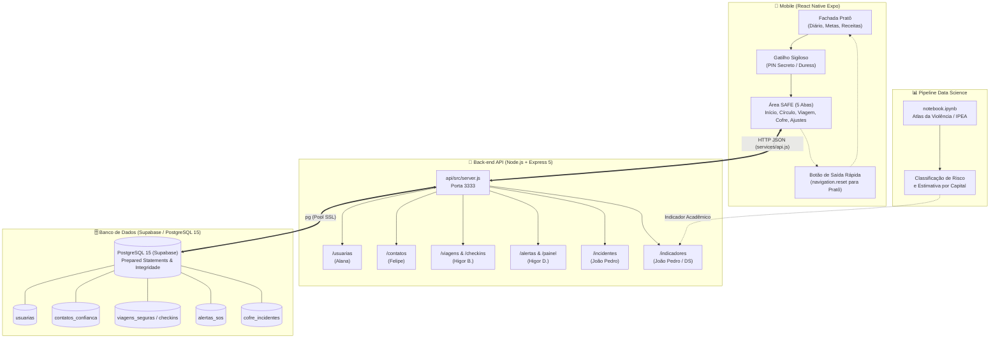

# 🥗 Pratô / SAFE (Sistema de Apoio e Fortalecimento Emergencial)

> ⚠️ **AVISO IMPORTANTE:** Este projeto é um **protótipo acadêmico** desenvolvido exclusivamente para fins educacionais e de conscientização dentro do Projeto Integrador das disciplinas de *Desenvolvimento Móvel* e *Data Science* da **Universidade Positivo (Campus Londrina - 2º Semestre/2026)**. Ele **NÃO** substitui atendimento oficial policial, jurídico, psicológico ou de saúde. Em casos de emergência real no Brasil, utilize os canais oficiais:
> * 📞 **Ligue 180** — Central de Atendimento à Mulher (Gratuito, 24h, anônimo).
> * 🚨 **190** — Polícia Militar (Situações de emergência e flagrante).

---

## 📱 Visão Geral do Projeto

O **Pratô** apresenta-se à primeira vista como um aplicativo inofensivo e funcional de **controle de rotina alimentar, metas e diário de refeições**. No entanto, por trás de gatilhos numéricos ou gestos específicos, a usuária acessa o **SAFE**: uma plataforma discreta de segurança pessoal dividida no modelo **Antes, Durante e Depois**.

```
                           +----------------------------------------+
                           |          FACHADA: "PRATÔ"              |
                           |   (Diário de Dieta / Calorias / Metas) |
                           +-------------------+--------------------+
                                               |
                                    [ PIN Secreto / Long Press ]
                                               v
                           +----------------------------------------+
                           |             ÁREA: "SAFE"               |
                           +-------------------+--------------------+
                                               |
           +-----------------------------------+-----------------------------------+
           |                                   |                                   |
           v                                   v                                   v
+-----------------------+           +-----------------------+           +-----------------------+
|  🟢 ANTES (Prevenção)  |           |  🟡 DURANTE (Socorro)  |           |  🔴 DEPOIS (Registro) |
| - Círculo de Confiança|           | - SOS Silencioso      |           | - Cofre de Incidentes |
| - Viagem Segura       |           | - GPS em Tempo Real   |           | - Registro de Provas  |
| - Check-in Programado |           | - Painel da Delegacia |           | - Guia de Apoio / 180 |
+-----------------------+           +-----------------------+           +-----------------------+
```

---

## 🏗️ Arquitetura Integrada da Solução (Entrega Final)

Na Entrega Final, o aplicativo mobile deixa de usar arrays em memória e passa a operar conectado a uma API RESTful corporativa em **Node.js/Express**, persistida em banco **PostgreSQL no Supabase** e integrada aos modelos preditivos de **Data Science**.



---

## 📋 Tabela de Conformidade da Entrega Final

| Exigência da Entrega | Onde está implementado | Responsáveis | Situação |
|---|---|---|:---:|
| **Back-end (API RESTful)** em Node.js/Express, modular com rotas completas | `api/src/server.js` e `api/src/rotas/` | Alana, Felipe, Higor B., Higor D., João Pedro | ✅ |
| **Banco de Dados Relacional** com as tabelas do DER no PostgreSQL | `api/sql/schema.sql` e `api/sql/seed.sql` no Supabase | Alana (#63) e Equipe | ✅ |
| **Validação de Relacionamentos Reais** pela API (ex: `usuaria_id` existente) | `garantirExiste()` em `api/src/erros.js` e checagem em `POST`/`PUT` | Equipe em suas rotas | ✅ |
| **Consumo Real no App Mobile** (Create, Read, Update, Delete via API) | `app/src/services/api.js` e páginas de cada módulo | Cada aluno em seu CRUD | ✅ |
| **Gatilho de Entrada e Saída Rápida (*Quick Exit*)** funcionando juntos | `PratoMetasScreen.js`, `BotaoSaidaRapida.js` e `SafeTabs.js` | Felipe Trindade (#77) | ✅ |
| **Data Science Completo:** modelagem, avaliação e indicador integrado | `data-science/notebook.ipynb` e Tela 17 com aviso acadêmico | Higor D., João Pedro, Felipe, Higor B., Alana | ✅ |
| **Governança & Rastreabilidade:** commits individuais e PRs com padrão | Histórico do Git (`Área: descrição (Nome) Closes #N`) | Todos os integrantes | ✅ |
| **Quadro Kanban e Registro de IA:** avanço real e prompts documentados | [GitHub Projects](https://github.com/users/alanakaled10/projects/1) / [kanban-backlog.md](docs/kanban-backlog.md) e [USO_IA.md](USO_IA.md) | Todos os integrantes | ✅ |

---

## 👥 Matriz de Responsabilidades da Entrega Final

| Integrante | Módulo / CRUD | Tabela (Supabase) | Rotas da API | Telas do App Integradas | Etapa de Data Science |
| :--- | :--- | :--- | :--- | :--- | :--- |
| **Alana Caled** | Perfil, Usuárias & Camuflagem | `usuarias` | `/usuarias` | Telas 13 e 14 (Ajustes e Apagar Dados), Primeiro Acesso (#87) | **Etapas 1 e 2:** Governança, LGPD e Aquisição de Dados |
| **Felipe Trindade** | Círculo de Confiança & Saída Rápida | `contatos_confianca` | `/contatos` | Tela 06 (`ContatosList`), Tela 07 (`ContatoForm`), `BotaoSaidaRapida` | **Etapa 5:** Análise Exploratória de Dados (EDA) |
| **Higor Bueno** | Viagem Segura & Check-ins | `viagens_seguras`, `checkins_viagem` | `/viagens`, `/checkins` | Tela 08 (`ViagemNova`), Tela 09 (`ViagemEmAndamento`) | **Etapas 3 e 4:** Qualidade, Tratamento e Execução Final |
| **Higor Domingos** | Alertas SOS & Painel Delegacia | `alertas_sos` | `/alertas`, `/painel` | Tela 05 (`SafeHome`), Tela 15 (`AlertasHistorico`), Painel Web | **Etapa 6:** Modelagem e Treinamento de Modelos |
| **João Pedro** | Cofre de Incidentes & Indicador DS | `cofre_incidentes`, `indicadores` | `/incidentes`, `/indicadores` | Tela 10 (`IncidentesList`), Tela 11 (`IncidenteForm`), Tela 12 (`Detalhe`), Tela 17 | **Etapas 6 e 7:** Avaliação de Métricas e Integração |

---

## 📊 Data Science: Pipeline e Etapas

O pipeline completo está implementado em [`data-science/notebook.ipynb`](data-science/notebook.ipynb), estruturado em seções com os responsáveis por cada entrega:

**Base escolhida:** [Atlas da Violência](https://www.ipea.gov.br/atlasviolencia/tema/61/) (IPEA e FBSP, a partir do SIM/Ministério da Saúde), séries "Homicídios Mulheres" e "Taxa de Homicídios Mulheres", 27 capitais, 1989 a 2022 (918 linhas: capital × ano). Dados públicos, agregados e sem informação pessoal; acesso em 18/10/2026. Serve ao app porque mostra onde e quando a violência letal contra a mulher é maior e permite gerar um indicador de contexto por capital para a tela de Autoavaliação (Tela 17), sempre acompanhado de aviso explícito de estimativa acadêmica.

**Limitações:** Subnotificação e mortes registradas como "causa indeterminada"; transição da CID-9 para CID-10 em 1996; restrito a capitais brasileiras; foco em homicídios.

| Etapa | Responsável | O que foi realizado no notebook |
| :--- | :--- | :--- |
| **1 e 2. Governança, aquisição e dicionário** | Alana Caled | Ficha da base, conformidade com a LGPD, limitações, carga de dados e dicionário de tipos estatísticos |
| **3 e 4. Qualidade e tratamento** | Higor Bueno | Diagnóstico nas 5 dimensões de qualidade, tratamento pedagógico, tabela de decisões e comparação antes × depois |
| **5. Análise exploratória (EDA)** | Felipe Trindade | Medidas resumo, distribuição de frequências, série histórica, correlações e respostas às 3 perguntas de negócio |
| **6. Modelagem de Machine Learning** | Higor Domingos | Definição de alvo, comparação e treino de algoritmos supervisionados para classificação de risco |
| **7. Avaliação e Integração** | João Pedro | Métricas completas (Acurácia, F1, Recall, Matriz de Confusão), validação cruzada e endpoint para o indicador da Tela 17 |

**Decisões de tratamento:** A base bruta permanece intacta em `data-science/dados/` (arquivos CSV originais). Na limpeza, os 6 zeros (Palmas nos primeiros anos e Natal em 2004) e os 16 outliers da taxa foram **mantidos e sinalizados** como anos reais de alta violência. Foram criadas as variáveis `regiao` e `faixa_risco`. A base unificada é `capitais_homicidios_mulheres.csv` e a tratada é `capitais_dados_processados.csv`.

---

## 🗂️ Quadro Kanban e Acompanhamento

* **Quadro no GitHub Projects:** [Acompanhamento em tempo real das sprints e status das issues](https://github.com/users/alanakaled10/projects/1)
* **Histórico e Backlog em Markdown:** [docs/kanban-backlog.md](docs/kanban-backlog.md)

---

## ▶️ Como Rodar o Projeto

### 1. Pré-requisitos
* [Node.js](https://nodejs.org) versão 20 ou superior instalada.
* Celular com o aplicativo [Expo Go](https://expo.dev/go) instalado ou um emulador Android/iOS configurado.

---

### 2. Rodando a API Back-end

1. Abra um terminal e acesse a pasta da API:
   ```bash
   cd api
   npm install
   ```
2. Configure as variáveis de ambiente:
   * Copie o arquivo `.env.example` para `.env`:
     ```bash
     cp .env.example .env
     ```
   * Preencha a `DATABASE_URL` com a string de conexão do Supabase (solicite a credencial com a equipe). O arquivo `.env` nunca deve ser versionado no Git.
3. Inicie o servidor Express:
   ```bash
   npm start
   ```
   *(ou `npm run dev` para recarregar automaticamente a cada alteração)*.
4. Confirme que a API está ativa acessando no navegador: `http://localhost:3333/`. A resposta esperada é:
   ```json
   { "status": "ok", "banco": "ok", "api": "Pratô / SAFE" }
   ```

---

### 3. Rodando o Aplicativo Mobile (Expo)

1. Em um segundo terminal, acesse a pasta do app:
   ```bash
   cd app
   npm install
   ```
2. **Configuração do endereço da API (`BASE_URL`):**
   * Abra o arquivo [app/src/services/api.js](app/src/services/api.js).
   * **Navegador Web / Emulador:** pode manter `http://localhost:3333` (ou `http://10.0.2.2:3333` no emulador Android Studio).
   * **Celular Físico com Expo Go:** o smartphone precisa alcançar o computador na mesma rede Wi-Fi. Descubra o IP da sua máquina (`ipconfig` no Windows) e defina:
     ```javascript
     export const BASE_URL = 'http://192.168.0.XX:3333'; // Seu IP local
     ```
3. Inicie o bundler do Expo:
   ```bash
   npx expo start
   ```
4. Escaneie o QR Code com o aplicativo **Expo Go** no seu celular ou pressione `w` para abrir no navegador.

---

### 4. Como testar o fluxo de segurança do protótipo

1. **Fachada Pratô:** O app inicializa na tela inofensiva de dieta (Diário de calorias e refeições).
2. **Gatilho de Entrada Secreta:**
   * Navegue até a aba **Metas** e digite o PIN secreto padrão da usuária (`1234`) no campo de meta de calorias; ou
   * Dê um toque longo sobre o logotipo do Pratô no topo da tela inicial.
3. **Área Segura (SAFE):** O app executa a transição imediata para a área restrita com as abas Início, Círculo, Viagem, Cofre e Ajustes.
4. **CRUDs pela API:** Cadastre, liste, edite e exclua registros (ex: contatos no Círculo de Confiança). Os dados serão salvos diretamente no Supabase via chamadas à API Express.
5. **Gatilho de Saída Rápida (*Quick Exit*):**
   * Em qualquer tela ou formulário do SAFE, toque no botão camuflado **"Salvar rascunho"** no canto superior direito.
   * O app executa imediatamente `navigation.reset` para a Fachada Pratô, limpando todo o histórico do SAFE da memória (pressionar o botão "Voltar" do Android jamais reabre a área segura).

---

## 🗂️ Estrutura do Repositório

```text
PratoApp/
├── app/                      # Aplicativo Mobile em React Native (Expo)
│   └── src/
│       ├── pages/
│       │   ├── prato/        # Fachada: Diário, Metas, Receitas
│       │   └── safe/
│       │       ├── inicio/   # Início/SOS, Alertas, Guia, Autoavaliação, Resultado
│       │       ├── circulo/  # Círculo de Confiança (CRUD do Felipe)
│       │       ├── viagem/   # Viagem Segura (CRUD do Higor B.)
│       │       ├── cofre/    # Cofre de Incidentes (CRUD do João Pedro)
│       │       └── ajustes/  # Perfil, Camuflagem e Apagar Dados (Alana)
│       ├── components/       # Botões, Chips, BotaoSaidaRapida
│       ├── routes/           # RootStack, PratoTabs, SafeTabs e Stacks de cada aba
│       ├── assets/           # Logo, ícones e fontes
│       ├── theme/            # Paleta de cores oficial e tipografia Poppins
│       └── services/         # Integração HTTP com a API Express (services/api.js)
├── api/                      # Back-end Node.js / Express 5
│   ├── src/
│   │   ├── rotas/            # usuarias.js, contatos.js, viagens.js, alertas.js, incidentes.js
│   │   ├── db.js             # Conexão Pool com PostgreSQL (Supabase)
│   │   ├── erros.js          # Middleware central de tratamento e validação de integridade
│   │   └── server.js         # Servidor Express com carregamento dinâmico de rotas
│   └── sql/                  # schema.sql e seed.sql para o PostgreSQL
├── painel/                   # Dashboard Web em tempo real para a Delegacia
├── data-science/             # Pipeline de Ciência de Dados
│   ├── dados/                # Bases públicas (Atlas da Violência / IPEA)
│   └── notebook.ipynb        # Notebook com EDA, pré-processamento, modelos e métricas
├── docs/                     # Documentação de arquitetura, DER, Kanban e matriz
├── USO_IA.md                 # Registro oficial de uso de Inteligência Artificial
└── README.md                 # Este documento
```

---

## 📄 Documentação Técnica do Projeto

1. [Matriz de Papéis e Responsabilidades](docs/matriz-papeis.md)
2. [Modelagem do Banco de Dados & DER](docs/modelagem-der.md)
3. [Backlog e Quadro Kanban (Markdown)](docs/kanban-backlog.md) e [Quadro Kanban no GitHub Projects](https://github.com/users/alanakaled10/projects/1)
4. [Justificativa e Especificação do Disfarce Pratô](docs/justificativa-disfarce.md)
5. [Fluxo de Telas e Navegação](docs/fluxo-de-telas.md)
6. [README da API Back-end](api/README.md)
7. [Registro de Uso de IA](USO_IA.md)
